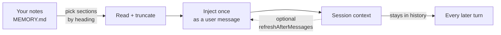

# ofttold-memory · Oft-told

<p align="center"><a href="./README.md">中文</a> | <a href="./README.en.md">English</a></p>

<p align="center"><strong>Memory-injection plugin</strong> — <em>carry your memory into every session.</em></p>

<p align="center"><sub>a note helps only when it is in front of the model · <em>injected once, present throughout</em> · no dependence on remembering to look · works out of the box</sub></p>

<p align="center"><sub><strong>A DSH plugin</strong> · other harnesses: planned</sub></p>

<p align="center">
<a href="https://www.npmjs.com/package/ofttold-memory"></a>
<a href="https://github.com/IcyDate/ofttold-memory/blob/main/LICENSE"></a>
<a href="https://github.com/IcyDate/ofttold-memory"></a>
</p>

<p align="center">
<code>dsh plugin --profile web add ofttold-memory</code>
</p>

<p align="center">
<a href="https://www.deepseek.com" title="deepseek-harness (dsh)"></a>&nbsp;
<a href="https://nodejs.org" title="Node.js 22+"></a>&nbsp;
<a href="https://www.apple.com/macos" title="macOS"></a>&nbsp;
<a href="https://www.microsoft.com/windows" title="Windows"></a>&nbsp;
<a href="https://www.linux.org" title="Linux"></a>
</p>

---

> **At a glance:** your notes are read once and injected once, then present in every later turn — **zero cost after the first turn.** 600 characters is about 400 tokens, charged once per session. Nothing to configure after install.



One read, one injection. No index, no embeddings, no database, no second pass.

---

## Quick start

```sh
dsh plugin --profile web add ofttold-memory
```

**That is the whole setup.** It installs the prebuilt package from npm — no build step,
so no build approval is needed. To track the repository instead, use
`github:IcyDate/ofttold-memory` in place of the package name. The first run creates `~/.dsh/ofttold-memory/` with a
four-file skeleton: `MEMORY.md` (the injected source), `INDEX.md` (the diary index),
`relationship.md` (who the assistant is, plus the live emotion value), and `diary/`
(one file per day). **All of it is empty shells and comments — not one memory is
pre-filled**, because what to remember is the one thing nobody can decide for you. Point `memoryDir` at a folder you already use — a diary, an index, a rules file — and it
**fills in only the files that are missing, never rewriting one that exists**. That
typically means adding `relationship.md` (where the emotion vocabulary and cache live)
and `diary/` (which the end-of-block nudge depends on); without them the writing half
of the scheme is absent.

Then open **Settings → 拾光 / Oft-told** to adjust it with a mouse, or edit the
profile's `cordis.patch.yml` by hand.

---

## What goes in the file

```markdown
# My memory

## Oft-told

> Cap of 8 suggested. When it is full, one entry is evicted — and the eviction
> itself is the ranking, which beats "add one whenever it comes to mind".

- **Where the project is** → `~/work/my-project` | saves asking every time
- **What not to touch** → do not edit `config/prod.yml`

## Who I am

- (how you address me, speech habits, temper, what I care about)

## Hard rules

- (things whose absence causes wrong work: who owns what, commands never to run)
```

**One test for what belongs:** would getting this wrong without seeing it cause a
mistake? Not "important", not "mentioned often" — *"not seeing this would break
the work"*. Written to that test, eight entries are plenty; written to "important",
nothing is ever enough.

## What sinks when the list is full

Past eight anchors nothing asks a person to delete a line — it is ranked:

```
R = exp(-t / 2^n)     t = days since the anchor's own date
                      n = distinct days that recalled it (ten mentions in a day are one)
```

- A dated anchor uses its own date; one pointing at `relationship.md` or a folder gets a
  `` `date` 起 `` stamp the first time it is seen.
- **Age alone never evicts.** Each recall doubles the interval, so an old line everyone
  keeps reaching for outranks a fresh one nobody touches.
- What sinks **stays in the file** and simply stops being injected; a diary day mentioning
  it again floats it back. The view forgets, the record does not.
- `anchorCap` of `0` turns it off.

## The day opens with a paragraph

A day's file starts with `## 今天（17:40 更新）` — two or three sentences saying what the day
was and what it was like, grumbling included. Detail lives below it, for whoever wants it.

It is **rewritten as the day is written**, not filled in at night. The plugin compares the
`（HH:mm 更新）` stamp with the last `## HH:mm` heading, so a body that keeps growing after
its summary is named instead of quietly going stale. `summaryFrom` (default `17:30`) holds
the requirement back until the day is actually far enough along to summarise.

## The diary check

The same line reports three more things, and **reports only**:

| What it sees | What it says |
|---|---|
| More than `diarySections` sections (default 8) | `9 sections, over the 8-per-day bar` |
| A section with no `情绪：` line | `2 sections without an \`情绪：\` line` |
| No summary after `summaryFrom` | `no \`## 今天\` summary at the top` |
| A summary that lags the body | `summary stopped at 17:40, body runs to 21:10` |

**Why it never repairs anything**: consolidating means compressing, and compressing deletes
the evidence the weight counts — it counts *how many days recalled this*, so folding a day
into a paragraph makes those days disappear and old anchors age out for no reason. The diary
is also never injected (only one section of the index is), so it costs nothing per session:
compressing it trades a real loss for no gain.

## Setting an emotion

The `**现在**` line in `relationship.md` is the **live value**: the feeling right now, no
reason attached. It is written by tool, not by remembering a format:

```
remember_emotion(word: "定")
→ 现在：`定`（2026-10-30 11:20 更新）（原来是 `心虚`）
```

- The word must be in the same file's `## 情绪词表` section, or it is **refused** with the
  list of words that exist.
- A missing vocabulary section is also refused — inventing a default list here would be one
  more copy that drifts.
- Only the backticked value and the timestamp change; the rest of the line is untouched.

**Why a tool and not a paragraph**: this line changes several times a day, and both ways to
get it wrong are silent — a word outside the list stops matching any diary tag, and a stale
timestamp makes the cache look fresher than it is.

## The line at the end

If the folder has a `diary/`, the injected block closes with one more sentence: today's
entry is not written yet, here is the path. It costs a single `stat`, and it means
"write today or not" stops depending on remembering.

A folder without a diary never gets that line, so there is nothing to switch off —
the layout answers the question.

---

## The settings that matter

| Setting | Default | Meaning |
| --- | --- | --- |
| `memoryDir` | `~/.dsh/ofttold-memory` | Your memory folder. Missing files are filled in on first run; existing ones are never rewritten. |
| `sections` | `["Oft-told", "常被提起"]` | Which headings ride along. Just the heading text. |
| `maxChars` | `600` | Character budget per section. 600 characters ≈ 400 tokens. |
| `anchorCap` | `8` | How many bold bullets a section keeps in view; the rest sink without being deleted. `0` turns it off. |
| `summaryFrom` | `"17:30"` | When the day's `## 今天` summary starts being expected. |
| `diarySections` | `8` | Sections per day before the check names it. |
| `diaryCheck` | `true` | The diary check on or off. |

Everything else has a working default. The full field list, the object form of
`sections` for the rare per-section case, exact heading matching, and cross-platform
behaviour are in **[Configuration](docs/config.en.md)**.

---

## Where the name comes from

This plugin was extracted from a working arrangement between one person and one
agent, and it kept the name they gave it.

**拾光** (*shí guāng*) — to pick up the light, and a homophone of 时光, *time*. The
idea sits in **拾**: to gather back up, one piece at a time, what has scattered.

The arrangement was a folder of diaries, an index holding a short list of things
that keep coming back, and one instruction at the top of the agent's notes: *read
these two files before every session.* The instruction held until it did not — and
it failed exactly where it was meant to hold, at the start of a session, when the
new message is the only thing that matters.

So the instruction became a mechanism. That is the whole change: **the list moved
out of something the model had to remember into context it cannot miss.**

---

## Why not just put it in `AGENTS.md`?

Because an instruction and an injected message are not paid for the same way.

| | Cost per turn | Can it be skipped |
|---|---|---|
| A rule in `AGENTS.md` | every turn, the rule's full length | yes — silently |
| This plugin | **0 after the first turn** | no — already in history |

A system instruction rides along with every request. An injected message is paid
once: after the first turn it is history, and later turns read it as context they
already have. A measured injection is **735 characters ≈ 660 tokens, once per
session**; a rule costs its length on every turn, forever. The rule loses as soon
as the rule is longer than the injected block.

**Put the content in a memory file, not the instruction in `AGENTS.md`.**

---

## What it does, and what it leaves alone

**It does** the things that should happen every time and reliably get skipped:

- puts the list in front of the model, once per session
- when the list is full, computes which line sinks: `exp(-t / 2^n)`
- stamps a start date on anchors that have no date of their own
- fills in missing files, names an unwritten day, says what it tried when nothing loads

**It does not** do the half that needs judgement:

- **It does not decide what is worth remembering.** What goes on the list, and whether a
  sinking line deserves rescuing, is the writer's call. The plugin only does the arithmetic.
- **It does not decide what you feel.** The value is the writer's call; writing it is the
  plugin's — `remember_emotion` checks the vocabulary, stamps the time, and refuses a word
  that is not on the list.
- **It does not write the diary.** It names an unwritten day and stops there.

The line between the two is **"would the failure be visible?"** — invisible failures go to
code, visible ones stay with the writer. Reasoning is in
**[Design notes](docs/design.en.md)**.

---

## When nothing appears

A missing file or a renamed heading never throws. **When no section loads at all, the block
says what it tried:**

```
Could not load any section. Tried: INDEX.md → 常被提起 (heading_not_found)
```

`heading_not_found` is exact: `常被提起` does not match `常被提起（手动维护）`. An empty
folder gets a different sentence — *this is the first day, not a fault*.

**The record is still the answer:**

```sh
cat ~/.dsh/ofttold-memory/diagnostics.json
```

Every injection decision, with the folder, how many sections loaded, which failed
and why. **It never records the text of your notes**, so it is safe to paste into
an issue. The settings page has a **Copy issue summary** button for the same
information.

| `event` | Meaning |
|---|---|
| `injected` | Worked. `loaded` = sections, `chars` = block size. |
| `nothing-loaded` | Folder found, no configured heading matched — usually a renamed heading. The session gets a line naming each file and heading that was tried. |

An absent file means the plugin never reached a decision, which points at the
install rather than the content.

---

## Other harnesses

**Planned.** The plugin is tied to DSH; the same idea is meant to ship as a skill that any
harness can read. It has not run on a second harness yet, so no usage is documented here.

---

## License

MIT.
