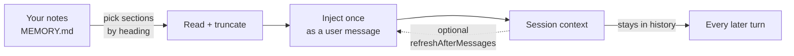

# ofttold-memory · Oft-told

<p align="center"><a href="./README.md">中文</a> | <a href="./README.en.md">English</a></p>

<p align="center"><strong>Memory-injection plugin</strong> — <em>carry your memory into every session.</em></p>

<p align="center"><sub>a note helps only when it is in front of the model · <em>injected once, present throughout</em> · no dependence on remembering to look · works out of the box</sub></p>

<p align="center"><sub><strong>A DSH plugin</strong> · the same skill for other harnesses: <a href="./docs/skill.en.md">spec</a></sub></p>

<p align="center">
<a href="https://github.com/IcyDate/ofttold-memory/blob/main/LICENSE"></a>
<a href="https://github.com/IcyDate/ofttold-memory"></a>
</p>

<p align="center">
<code>dsh plugin --profile web add github:IcyDate/ofttold-memory</code>
</p>

<p align="center">
<a href="https://www.deepseek.com" title="deepseek-harness (dsh)"></a>&nbsp;
<a href="https://nodejs.org" title="Node.js 22+"></a>&nbsp;
<a href="https://www.apple.com/macos" title="macOS"></a>&nbsp;
<a href="https://www.microsoft.com/windows" title="Windows"></a>&nbsp;
<a href="https://www.linux.org" title="Linux"></a>
</p>

---

> **At a glance:** your notes are read once and injected once, then present in every later turn — **zero cost after the first turn.** 600 characters is about 400 tokens, charged once per session. Nothing to configure after install.



One read, one injection. No index, no embeddings, no database, no second pass.

---

## Quick start

```sh
dsh plugin --profile web add github:IcyDate/ofttold-memory
```

**That is the whole setup.** It installs the code as it sits in the repository — no
build step, so no build approval is needed. The first run creates `~/.dsh/ofttold-memory/` with a
four-file skeleton: `MEMORY.md` (the injected source), `INDEX.md` (the diary index),
`relationship.md` (who the assistant is, plus the live emotion value), and `diary/`
(one file per day). **All of it is empty shells and comments — not one memory is
pre-filled**, because what to remember is the one thing nobody can decide for you. Point `memoryDir` at a folder you already use — a diary, an index, a rules
file — and the plugin only reads: **it never writes into a notes folder that
already has content.**

Then open **Settings → 拾光 / Oft-told** to adjust it with a mouse, or edit the
profile's `cordis.patch.yml` by hand.

---

## What goes in the file

```markdown
# My memory

## Oft-told

> Cap of 8 suggested. When it is full, one entry is evicted — and the eviction
> itself is the ranking, which beats "add one whenever it comes to mind".

- **Where the project is** → `~/work/my-project` | saves asking every time
- **What not to touch** → do not edit `config/prod.yml`

## Who I am

- (how you address me, speech habits, temper, what I care about)

## Hard rules

- (things whose absence causes wrong work: who owns what, commands never to run)
```

**One test for what belongs:** would getting this wrong without seeing it cause a
mistake? Not "important", not "mentioned often" — *"not seeing this would break
the work"*. Written to that test, eight entries are plenty; written to "important",
nothing is ever enough.

---

## The three settings that matter

| Setting | Default | Meaning |
| --- | --- | --- |
| `memoryDir` | `~/.dsh/ofttold-memory` | Your memory folder. Created on first run with the four-file skeleton. |
| `sections` | `["Oft-told", "常被提起"]` | Which headings ride along. Just the heading text. |
| `maxChars` | `600` | Character budget per section. 600 characters ≈ 400 tokens. |

Everything else has a working default. The full field list, the object form of
`sections` for the rare per-section case, exact heading matching, and cross-platform
behaviour are in **[Configuration](docs/config.en.md)**.

---

## Where the name comes from

This plugin was extracted from a working arrangement between one person and one
agent, and it kept the name they gave it.

**拾光** (*shí guāng*) — to pick up the light, and a homophone of 时光, *time*. The
idea sits in **拾**: to gather back up, one piece at a time, what has scattered.

The arrangement was a folder of diaries, an index holding a short list of things
that keep coming back, and one instruction at the top of the agent's notes: *read
these two files before every session.* The instruction held until it did not — and
it failed exactly where it was meant to hold, at the start of a session, when the
new message is the only thing that matters.

So the instruction became a mechanism. That is the whole change: **the list moved
out of something the model had to remember into context it cannot miss.**

---

## Why not just put it in `AGENTS.md`?

Because an instruction and an injected message are not paid for the same way.

| | Cost per turn | Can it be skipped |
|---|---|---|
| A rule in `AGENTS.md` | every turn, the rule's full length | yes — silently |
| This plugin | **0 after the first turn** | no — already in history |

A system instruction rides along with every request. An injected message is paid
once: after the first turn it is history, and later turns read it as context they
already have. A measured injection is **735 characters ≈ 660 tokens, once per
session**; a rule costs its length on every turn, forever. The rule loses as soon
as the rule is longer than the injected block.

**Put the content in a memory file, not the instruction in `AGENTS.md`.**

---

## What it deliberately does not do

No scoring, no decay curve, no emotion tagging, no guessing at importance. Those
need judgement, and judgement is what fails first when attention is full. The plugin
puts a **human-written** list in front of you and stops there.

The reasoning behind the cap, the eviction weight, and the emotion vocabulary is in
**[Design notes](docs/design.en.md)** — worth reading once, not needed to use it.

---

## When nothing appears

A missing file or a renamed heading never throws. The block carries one line
instead: `Unavailable: <name>: <reason>`.

If no section loads at all, the injection is skipped entirely and nothing appears
anywhere — which looks like the plugin is dead. **The record is the answer:**

```sh
cat ~/.dsh/ofttold-memory/diagnostics.json
```

Every injection decision, with the folder, how many sections loaded, which failed
and why. **It never records the text of your notes**, so it is safe to paste into
an issue. The settings page has a **Copy issue summary** button for the same
information.

| `event` | Meaning |
|---|---|
| `injected` | Worked. `loaded` = sections, `chars` = block size. |
| `nothing-loaded` | Folder found, no configured heading matched — usually a renamed heading. |

An absent file means the plugin never reached a decision, which points at the
install rather than the content.

---

## Other harnesses

The plugin is DSH-specific: it registers a Cordis plugin and injects a message into a
session, and that mechanism does not exist outside this harness.

**To carry the same idea elsewhere, use a skill:** one `SKILL.md`, usable by any
harness that reads skills, with no plugin API to implement. Both are written
([`skills/ofttold-memory/SKILL.md`](skills/ofttold-memory/SKILL.md) for which sections
to read, [`skills/ofttold-ritual/SKILL.md`](skills/ofttold-ritual/SKILL.md) for how to
write) and checked against the real frontmatter contract.

The layering is not either/or: **one spec, one adapter per harness.** Those two
`SKILL.md` files are the spec; DSH's adapter is this plugin (it publishes them with
`ctx.skills.register()`); other harnesses are missing their few dozen lines.

Worth being clear about what it loses: **a skill is discovered, not injected**, and
its body is read only when called. It cannot remove the decision to look — it can only
make that decision cheaper. The plugin removes the decision itself.

So this says planned, not supported — the details and the three open items are in
**[Skill version](docs/skill.en.md)**.

---

## License

MIT.
